<div align="center">

# RF Filter: Design, EM Simulation, Fabrication, VNA Measurement and De-embedding

### A microstrip filter, designed from theory and checked against a real board


</div>

---

## About me

I'm **Abdulrahman**, a second-year B.Sc. student in **Electrical and Computer Engineering** at
**Constructor University** in Bremen, Germany.

I'm building this project because I want to understand RF and microwave engineering by doing all of
it: the theory, the simulation, the board, and the measurement. I'd rather find out where a design
breaks than assume it works. This repository is the record of that process, including the decisions
I got wrong and the questions I couldn't yet answer.

Working on it with a mentor from the university's RF/microwave research group.

---

## Goal

Design a microstrip RF filter from first principles, simulate it at three levels of fidelity in
Keysight ADS, fabricate it as a printed circuit board, measure it on a vector network analyzer (VNA),
and **explain every difference** between the predicted and the measured response.

> **Core question.** How closely can a theoretically designed RF microstrip filter reproduce its
> intended response as we move from analytical design to circuit simulation, planar EM simulation,
> fabrication, and VNA measurement?
>
> **Stretch question.** How much of the gap between measurement and prediction comes from the
> connectors, launches and fixtures, and how does de-embedding change the extracted device response?

**The project is done when it has:**

- ✅ a defensible filter specification, and a design derived from theory
- ✅ ADS circuit and microstrip simulations, and planar EM if Momentum is licensed
- ✅ a manufacturable, fabricated board
- ✅ a two-port VNA measurement, with the raw data kept
- ✅ a five-way comparison (theory, ideal circuit, microstrip circuit, EM, measured), with each major
  discrepancy explained or listed as unexplained

De-embedding is a stretch goal. If the evidence shows it isn't defensible with the equipment
available, documenting that finding **completes** the goal properly.

**Not in scope.** No novelty claim. No production product. No filter dimensions are set until the
gates below have passed.

---

## Where things stand

> **Phase 0: scope and hardware constraints. Blocked at gate G0.**
> No filter has been designed, no dimensions calculated, no measurement taken.

The project waits on five hardware facts from the mentor: the substrate (εr, loss tangent, thickness),
the fabricator's minimum trace width and gap, the VNA and its frequency range, the calibration kits,
and the connector type. Each is marked **BLOCKED** in
[`design/hardware_constraints.md`](design/hardware_constraints.md) until answered. Nothing is assumed
to fill a blank.

| | Milestone | Gate | Status |
|:-:|---|:-:|---|
| ✅ | Plan, research basis and repository | (M0) | Done, 2026-10-02 |
| ⏸️ | Hardware constraints known | G0 | **Blocked**: waiting on mentor |
| ⬜ | Topology chosen, specification defensible | G3 | Not started |
| ⬜ | Ideal circuit meets specification | G5 | Not started |
| ⬜ | Microstrip circuit meets spec and is manufacturable | G6 | Not started |
| ⬜ | Measurement strategy frozen before layout | G8 | Not started |
| ⬜ | PCB passes design review and is ordered | G9 | Not started |
| ⬜ | VNA calibrated and verified | G10 | Not started |
| ⬜ | Measurements taken, repeatability quantified | G11 | Not started |
| ⬜ | Five-way comparison, discrepancies attributed | G12 | Not started |

Full list: [`planning/milestones.md`](planning/milestones.md). **No calendar dates yet.** They're set
once G0 reveals the fabrication lead time, because a schedule built on an unknown lead time is guesswork.

**Read first:** [`PROJECT_STATE.md`](PROJECT_STATE.md) (two-minute snapshot), then
[`HANDOFF.md`](HANDOFF.md) (what a new reader or AI session needs to resume).

---

## How I'll build it

Five stages. Each ends at a **gate**: objective evidence that the next stage may begin. Gates can be
reached at different times, but none is skipped. The full plan (15 phases, 14 gates, validation
methods and fallback routes) is in [`MASTER_PROJECT_PLAN.md`](MASTER_PROJECT_PLAN.md).

```mermaid
flowchart LR
    S0["Phase 0<br/>Constraints"]:::now -->|"G0"| S1
    S1["1 · Foundations<br/>ADS, two-ports"] -->|"G1–G2"| S2
    S2["2 · Design<br/>topology, prototype"] -->|"G3–G4"| S3
    S3["3 · Simulation ladder<br/>ideal → microstrip → EM"] -->|"G5–G7"| S4
    S4["4 · Fabrication<br/>measurement plan, PCB"] -->|"G8–G9"| S5
    S5["5 · Measurement<br/>VNA, five-way comparison"] -->|"G10–G12"| R["Report + seminar"]
    classDef now fill:#fff3cd,stroke:#b58105,color:#000
```



<details>
<summary><b>Stage 1: Foundations</b> (P1–P2, gates G1–G2)</summary>

Get fluent in the tools and the theory before designing anything.

- **ADS:** transmission lines, first simulations, schematic and data-display workflow.
- **Two-ports:** S-parameters, reference impedance, ABCD and T matrices, cascading, and conversions.
- **Method:** every concept is checked twice, by hand and in ADS, and the answers must match.

**Exit:** I can say what S₁₁ and S₂₁ mean on a real simulation, and cascade two networks by hand to
the answer ADS gives.

</details>

<details>
<summary><b>Stage 2: Design</b> (P3–P4, gates G3–G4)</summary>

Choose the filter from the constraints, not from habit.

- Score candidate topologies (low-pass or band-pass; stepped-impedance, coupled-line, hairpin and
  others) against the measured constraints in a decision matrix.
- Write the specification. Every number is either a sourced requirement or a declared arbitrary
  choice with a reason. Nothing is copied from an example.
- Derive the lumped prototype analytically. The **order is derived** from the specification, not chosen.

**Exit:** a specification and topology a supervisor can challenge, and a prototype that meets it.

</details>

<details>
<summary><b>Stage 3: Simulation ladder</b> (P5–P7, gates G5–G7)</summary>

The same filter, at three levels of fidelity. Each level must meet the specification before the next
starts. The differences between levels are results in their own right, so they're kept separate.

| Level | Tool | What it adds |
|---|---|---|
| Ideal circuit | ADS schematic | Ideal elements; tests the synthesis |
| Microstrip circuit | ADS transmission-line models, real substrate | Real widths, lengths and losses |
| Planar EM | ADS Momentum, **if licensed** | Full electromagnetic model of the layout |

The EM validation method is written down before any Momentum number is believed. Momentum is a 2.5-D
method-of-moments solver, so a volumetric convergence rule doesn't carry over.

**Exit:** all three levels meet the specification, and the EM validation procedure is written.

</details>

<details>
<summary><b>Stage 4: Fabrication</b> (P8–P9, gates G8–G9)</summary>

This is the stage that's hardest to undo, so the measurement strategy is settled first.

- **G8 freezes the measurement strategy before layout.** Anything it needs must go on the *same panel*
  as the filter, because it can't be added after fabrication:
  - a TRL (thru-reflect-line) calibration set on the board;
  - a 2x-thru coupon for IEEE 370-style de-embedding;
  - a port-extension or electrical-delay check, reported as the crude method it is.
- Lay out to the fabricator's minimum-width and minimum-gap limits, with the measurement structures included.
- Pass a written design review (DR-001), then order the board.

**Exit:** a manufacturable layout, a frozen measurement strategy, and an order placed.

</details>

<details>
<summary><b>Stage 5: Measurement and analysis</b> (P10–P12, gates G10–G13)</summary>

- **Calibrate and verify.** Calibrate with the available kit, then measure a verification standard that
  wasn't used in the calibration. An unverified calibration supports no claim.
- **Keep the raw data.** Touchstone files in `measurement/raw/` are append-only and never overwritten.
  Every processed result links back to them.
- **Quantify repeatability.** Every comparison carries that uncertainty.
- **Compare and attribute.** Build the five-way table. Name a mechanism for a discrepancy only with
  evidence: substrate εr error, etch tolerance, launch reflection, conductor or dielectric loss,
  connector repeatability, or a model omission. Anything unattributable is listed as *unexplained*.
- **Close the loop.** Re-simulate with measured substrate or etched dimensions, and check whether the
  discrepancy shrinks.
- **Conditional (P12):** de-embed the fixture **only if** G13 says the method is defensible. Otherwise
  the report says so and presents the measurement with the fixture included.

**Exit:** a measured response with uncertainty, a five-way comparison, and attribution where every
explanation has evidence.

</details>

<details>
<summary><b>Separate track: the seminar</b></summary>

A ~50-minute talk, with questions, for an undergraduate mathematics audience. It's built in parallel and
doesn't depend on the hardware. Roughly two-thirds (theory, speaker notes, Q&A preparation) can be done
before the board exists. Plan: [`seminar/SEMINAR_MASTER_PLAN.md`](seminar/SEMINAR_MASTER_PLAN.md). Which of
three versions (A, B, C) is delivered depends on what the evidence supports at the content freeze.

</details>

---

## Tools and open questions

| Item | Status |
|---|---|
| Keysight ADS (design environment) | ✅ **Confirmed**: mentor's recommendation |
| ADS Momentum (planar EM) | ❔ **Unconfirmed**. If unlicensed, the EM level is dropped and the report says so |
| VNA, frequency range, calibration kits | ⏸️ **Blocked**, waiting on mentor |
| Substrate: εr, tanδ, thickness, copper weight | ⏸️ **Blocked**, waiting on mentor |
| Fabricator: minimum width and gap, lead time | ⏸️ **Blocked**, waiting on mentor |
| Connector type and launch footprint | ⏸️ **Blocked**, waiting on mentor |
| Filter class, topology, centre frequency, order | ⏸️ **Blocked**, decided at G3 from the above |

Open decisions: [`planning/decision_log.md`](planning/decision_log.md). Blocked requirements:
[`planning/requirements.md`](planning/requirements.md).

---

## Evidence standard

- 🚫 **No invented data.** A measurement exists only once it's taken. A simulated value exists only once
  the simulation is run and its file committed.
- 🏷️ **Simulated is never shown as measured.** Every result says where it came from.
- 📝 **Every decision is recorded**, dated and with its reasoning, including decisions an AI assistant
  proposed.
- 🔗 **Every load-bearing claim has a source**: [`research/claims_and_sources.md`](research/claims_and_sources.md).
- ⏱️ **Gates aren't skipped to hit a date.** If a date can't be met, the deliverable shrinks; the
  evidence standard doesn't.
- 🎓 **Coursework comes first.** If the project starts costing coursework, it freezes at its current gate.

---

## References

- D. M. Pozar, *Microwave Engineering*, 4th ed., Wiley, 2011: transmission lines, S-parameters, ABCD
  matrices, filter design by insertion loss.
- J.-S. Hong and M. J. Lancaster, *Microstrip Filters for RF/Microwave Applications*, 2nd ed., Wiley,
  2011: coupled-line, hairpin and stepped-impedance microstrip filters.
- IEEE Std 370-2020: fixture de-embedding practice.

Only metadata is kept in this repository. Full records and verification status:
[`research/annotated_bibliography.md`](research/annotated_bibliography.md) and
[`research/verification_log.md`](research/verification_log.md).

---

<details>
<summary><b>Repository map</b></summary>

```
README.md                     this file
MASTER_PROJECT_PLAN.md        phases P0–P14 and gates G0–G13
PROJECT_STATE.md              live status snapshot
HANDOFF.md                    session-recovery document
LEARNING_PATH_FOR_ME.md       what to study now, and what to skip
PERSISTENCE.md                how the repository is backed up and pushed

planning/     requirements, milestones, decision log, risks, alternatives, mentor questions
research/     source hierarchy, bibliography, claim-to-source map, verification log
theory/       theory dependency map, each topic with a "you understand this when…" test
design/       hardware constraints, filter specification, topology selection, calculations
ads/          ADS exercises, circuit model, microstrip model, Momentum model
pcb/          manufacturing constraints, fabrication notes, exports
measurement/  measurement plan, calibration records, raw / processed / de-embedded data
results/      result register, tables, figures
seminar/      seminar plan, slide outline, source map, asset register, speaker notes
templates/    experiment, decision, result and source templates
```

</details>

<details>
<summary><b>Status labels and hard rules</b></summary>

**Status labels** used on every statement:

| Label | Meaning |
|---|---|
| **CONFIRMED** | Evidence-backed or finalized: needs a reference, a measurement or a logged decision |
| **PROVISIONAL** | Working choice, expected to be revisited |
| **OPTION** | A possible branch, not currently chosen |
| **BLOCKED** | Can't proceed until information arrives |
| **SUPERSEDED** | Historically relevant, no longer current |

A suggestion becomes CONFIRMED only through an entry in the decision log.

**Hard rules**

1. No invented data. Simulated values need a committed simulation file; measured values need a measurement.
2. No copyrighted textbooks, publisher PDFs or paywalled papers. Metadata only:
   [`research/source_hierarchy.md`](research/source_hierarchy.md).
3. Raw measurement data is append-only. Never overwrite a file in `measurement/raw/`.
4. No proprietary lab information: serial numbers, internal network paths, licence keys, unpublished
   group results, or anything a supervisor gave in confidence.
5. Every load-bearing technical claim has a source in [`research/claims_and_sources.md`](research/claims_and_sources.md).
6. Provisional stays provisional. Frequency, substrate, order, topology, response type, calibration and
   de-embedding method are not settled yet.

</details>

---

## Licence

© 2026 Abdulrahman. All rights reserved; no licence is granted for reuse. The repository is public so it
can be read and reviewed. Cited third-party works remain the property of their rights holders and are
referenced by metadata only.
